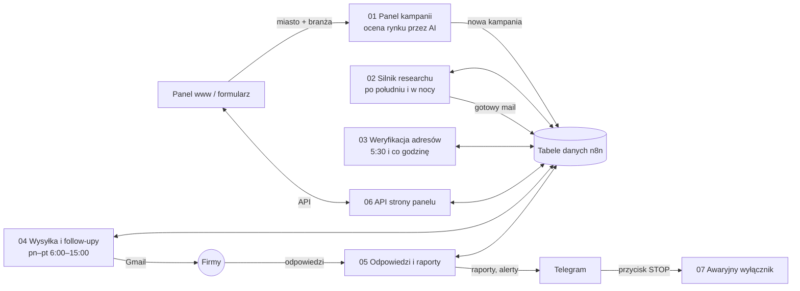

# Cold Mail AI

System do automatycznego cold mailingu dla polskich firm, zbudowany w n8n. Sam szuka firm w danym mieście i branży, robi research każdej z nich, znajduje prawdziwy adres e-mail, pisze maila prostym językiem, sprawdza go i wysyła w godzinach pracy. Potem pilnuje follow-upów i czyta odpowiedzi.

Zbudowałem go dla siebie, żeby docierać do firm z ofertą automatyzacji AI (MrozikDigital), i działa u mnie na produkcji.

---

## Co potrafi

- **Ocena rynku przed startem.** Wpisuję miasto i branżę, a system bierze próbkę firm z Google Maps, sprawdza ich strony i AI ocenia, czy taka kampania ma sens (werdykt, ocena 1–10, plusy, minusy, lepsze branże).
- **Szukanie firm.** Google Maps (Places API) i OpenStreetMap, z wieloma wariantami frazy i bez duplikatów.
- **Research każdej firmy.** Strona główna i podstrony (zwykłe pobieranie, a gdy się nie da, Firecrawl), opinie z Google i krótkie wyszukiwanie w internecie.
- **Tylko prawdziwe adresy.** E-mail musi być znaleziony na stronie albo w internecie. System niczego nie zgaduje i niczego nie składa z nazwy domeny.
- **Pisanie maila przez AI.** Zawsze ten sam, sprawdzony układ, bardzo prosty język, 3 konkretne propozycje dla danej branży.
- **Podwójna kontrola treści.** Najpierw kontrola w kodzie (długość, zakazane słowa, podobieństwo do innych maili), potem drugi model AI jako kontroler jakości. Słaby mail idzie do poprawki albo zostaje odrzucony.
- **Weryfikacja adresów przed wysyłką.** Format, domena i serwer poczty (MX). Złe adresy są wycofywane.
- **Wysyłka z Gmaila** w dni robocze od 6:00 do 15:00, z pominięciem świąt i długich weekendów, rozłożona równo w ciągu dnia i z losowymi przerwami.
- **Follow-upy** w tym samym wątku: po 3 i po kolejnych 4 dniach roboczych.
- **Odpowiedzi.** AI rozpoznaje, czy firma jest zainteresowana, czy pisze „nie teraz”, odmawia albo czy to tylko automat lub zwrot. Dla zainteresowanych przygotowuje szkic odpowiedzi z mini-analizą.
- **Raporty na Telegramie**: raport dnia o 18:00 i wnioski z tygodnia w niedzielę.
- **Panel www** (HTML na Netlify): stan systemu, kampanie, maile na dziś z możliwością odrzucenia i start nowej kampanii.
- **Awaryjny wyłącznik**: każdy alert na Telegramie ma przycisk, który jednym kliknięciem zatrzymuje cały system.

## Jak to działa



Dzień systemu wygląda tak:

| Godzina | Co się dzieje |
|---|---|
| 15:00–6:00 i weekendy | Silnik researchu szuka firm i przygotowuje maile na kolejne dni |
| 5:30 | Weryfikacja adresów z kolejki |
| 6:00–15:00 (pn–pt) | Wysyłka nowych maili i follow-upów, co 30 minut po kilka sztuk |
| co 15 minut | Sprawdzanie skrzynki i rozpoznawanie odpowiedzi |
| 18:00 | Raport dnia na Telegramie |
| niedziela 19:00 | Wnioski z tygodnia |

## Struktura repozytorium

```
cold-mail-ai/
├── README.md
├── workflows/                      # gotowe do importu pliki n8n
│   ├── 01-panel-kampanii.json
│   ├── 02-silnik-researchu.json
│   ├── 03-weryfikacja-adresow.json
│   ├── 04-wysylka-i-follow-upy.json
│   ├── 05-odpowiedzi-i-raporty.json
│   ├── 06-api-strony-panelu.json
│   └── 07-awaryjny-wylacznik.json
├── panel-www/
│   └── index.html                  # panel do wrzucenia na Netlify
├── database/
│   └── tabele.md                   # opis wszystkich tabel i statusów
├── docs/
│   ├── 01-architektura.md
│   ├── 02-instalacja.md
│   ├── 03-styl-maili.md
│   └── 04-koszty-i-optymalizacja.md
└── examples/
    └── przyklad-maila.md
```

## Technologie

- **n8n** (Cloud): 7 workflowów, wbudowane tabele danych (Data Tables), formularze i webhooki
- **OpenAI** (Responses API): `gpt-5.5` do pisania i kontroli jakości, `gpt-5.4-mini` do analizy i researchu, tryb `flex` dla niższych kosztów
- **Google Places API** i **OpenStreetMap (Overpass)** do szukania firm
- **Firecrawl** jako zapas, gdy strony nie da się pobrać zwykłym zapytaniem
- **Gmail API** do wysyłki i czytania odpowiedzi
- **Telegram** do alertów, raportów i awaryjnego wyłącznika
- **DNS over HTTPS** (dns.google) do sprawdzania serwerów poczty
- **HTML + CSS + JavaScript** w panelu www, bez frameworków

## Kilka liczb

- ok. **0,04 USD** kosztu AI na jeden gotowy, sprawdzony mail (po optymalizacji, wcześniej ok. 0,30 USD)
- ok. **4 000 wykonań** n8n miesięcznie przy pełnej pracy systemu
- **30** nowych maili dziennie (limit ustawiany osobno dla każdej kampanii) plus follow-upy

Więcej o tym w [docs/04-koszty-i-optymalizacja.md](docs/04-koszty-i-optymalizacja.md).

## Uruchomienie u siebie

Krótko: import 7 plików z `workflows/`, utworzenie tabel z `database/tabele.md`, podpięcie kont (OpenAI, Google, Gmail, Telegram, Firecrawl) i podmiana kilku wartości w kodzie. Dokładna instrukcja krok po kroku jest w [docs/02-instalacja.md](docs/02-instalacja.md).

> W plikach nie ma żadnych kluczy ani danych firm. Miejsca do uzupełnienia są oznaczone jako `TWOJ_...` i `ID_TABELI_...`.

## Autor

**Phillip Mrozik** · MrozikDigital

- www: [mrozikdigital.com](https://www.mrozikdigital.com)
- LinkedIn: [linkedin.com/in/phillip-mrozik-57105b428](https://www.linkedin.com/in/phillip-mrozik-57105b428)
- e-mail: mrozikdigital@gmail.com
